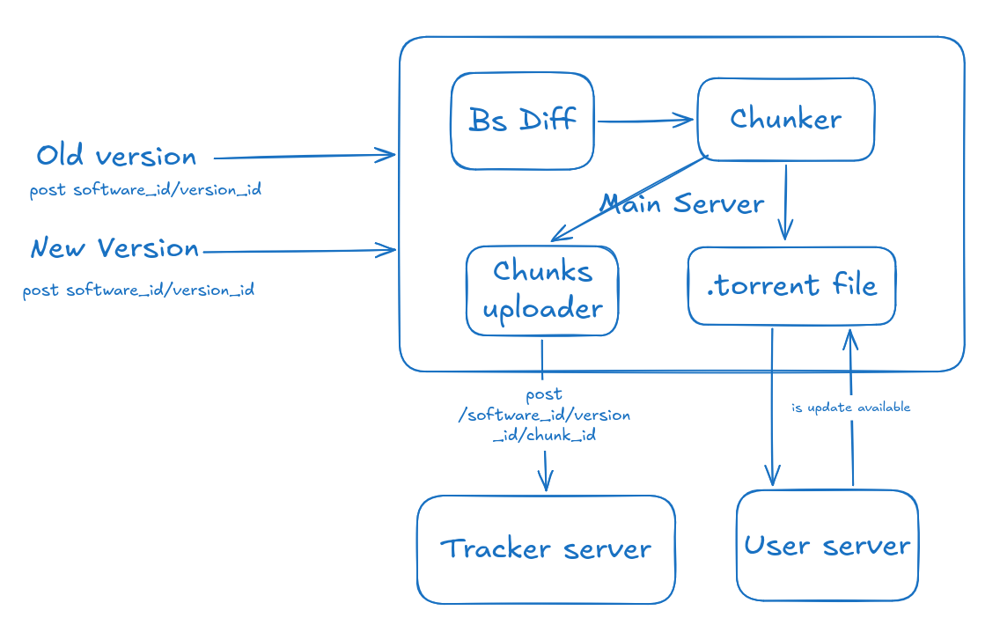
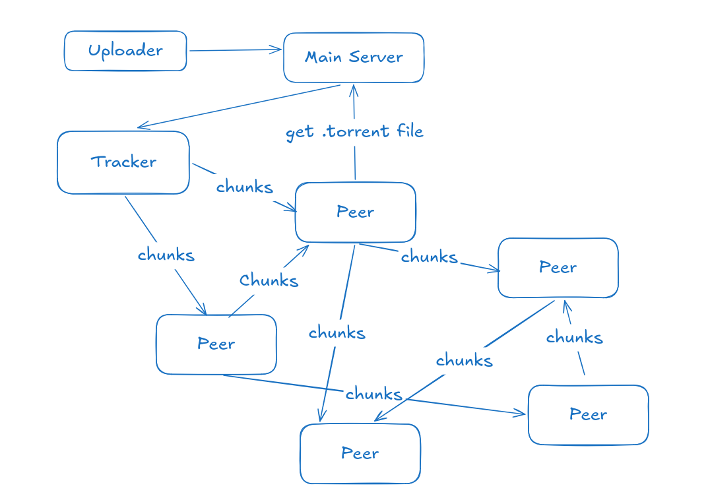
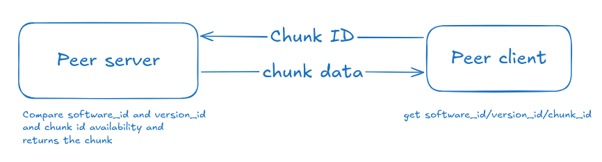
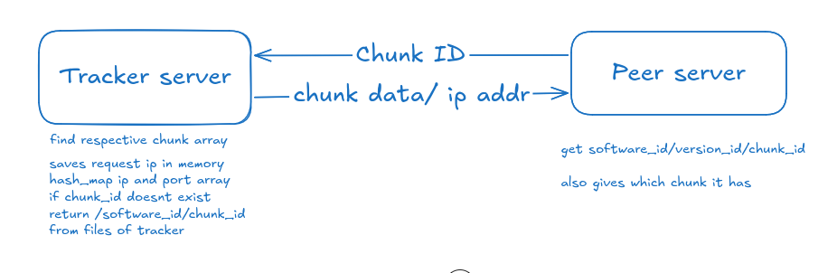
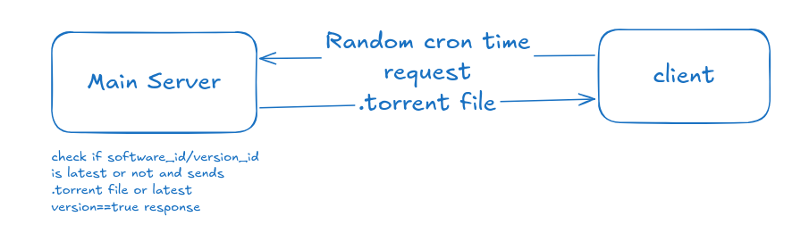
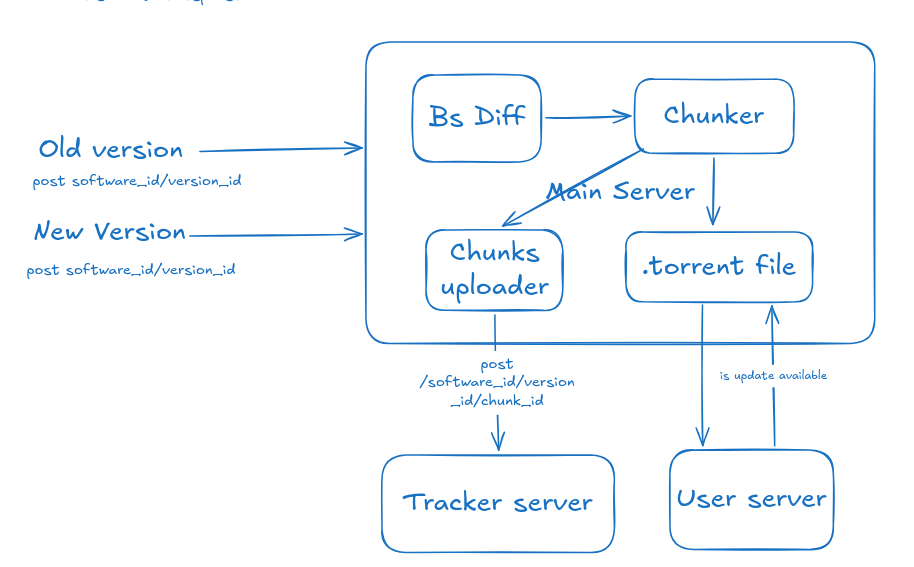
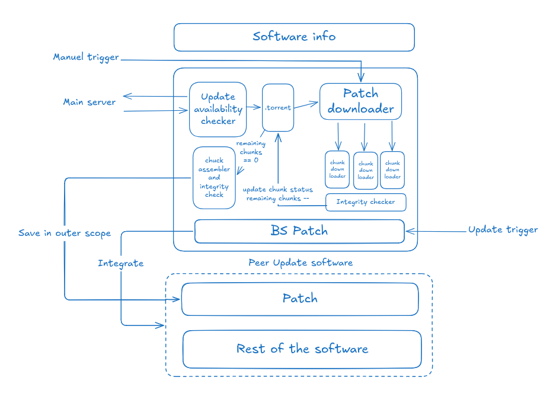
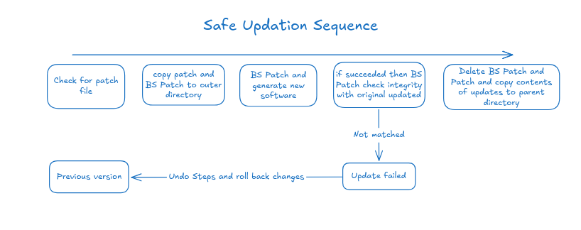

# DeSUDN — Decentralized Software Update Distribution Network

DeSUDN is a peer-to-peer (P2P) software update distribution system designed to reduce dependence on a central server. It divides software updates into smaller chunks that can be downloaded from multiple peers instead of requiring every client to download the entire update from the main server.

## 1. System Architecture

The system consists of the following components:

- **Main Server:** Manages software versions, update availability, and release metadata. It provides clients with the metadata required to obtain an update.
- **Uploader:** Submits the old and new software versions for processing.
- **BS Diff:** Generates a binary patch representing the differences between software versions, reducing the amount of data that may need to be distributed.
- **Chunker:** Divides the distributable data into smaller chunks and generates identifiers for them.
- **Chunks Uploader:** Sends chunk information to the tracker so that chunk availability can be recorded.
- **Torrent File:** Contains metadata describing the release and its chunks, allowing clients to identify the data required for an update.
- **Tracker Server:** Maintains information about peers holding particular chunks and helps clients discover available sources.
- **Peer Server and Client:** Enable peers to serve and download chunks directly from one another.
- **Update Client:** Checks for new versions, downloads required data, verifies it, and applies the update.

## 2. Peer-to-Peer Distribution

The main server provides the release metadata, while the tracker helps clients discover peers that have the required chunks. Peers then exchange chunks directly, allowing multiple peers to contribute to a single download.

As peers obtain chunks, they can make them available to other peers, helping distribute the network's upload workload.

## 3. Chunk Transfer

A peer client requests a chunk using identifiers such as `software_id`, `version_id`, and `chunk_id`. The peer server checks whether the requested chunk is available and returns its data.

The receiving peer can verify the chunk against the expected hash before accepting it.

## 4. Tracker and Peer Discovery

The tracker maps chunk identifiers to peers that advertise having those chunks. When a peer requests a chunk, the tracker helps identify potential sources.

The tracker assists with **peer discovery**, while the actual chunk data is transferred directly between peers.

## 5. Update Availability

The client contacts the main server to check whether its installed software version is current. The server compares the supplied `software_id` and `version_id` with the latest available release.

If an update exists, the client receives the relevant release metadata; otherwise, it can continue using the installed version.

## 6. Main Server and Tracker Workflow

During release publication, the main server makes the torrent metadata available to clients. The tracker handles chunk availability and peer discovery, enabling clients to locate sources before downloading the required data.

This separates **release management** from **peer-to-peer data distribution**.

## 7. Client-Side Update Pipeline

The update client coordinates the update process:

1. Check whether a newer version is available.
2. Retrieve the release metadata.
3. Identify and download the required chunks.
4. Verify the downloaded data.
5. Assemble the patch and apply it to the software.
6. Validate the updated result before completing the update.

The download and verification stages can be organized to process multiple chunks efficiently.

## 8. Safe Update and Rollback

To avoid leaving software in an unusable state, the client stages the patch and applies it to produce an updated version. It then checks the result against the expected integrity information.

If validation succeeds, the updated software replaces the previous version. If validation fails, the update is treated as unsuccessful and the previous working version is retained or restored.

## 9. Example API Routes

The architecture uses identifiers such as `software_id`, `version_id`, and `chunk_id` to identify releases and their chunks.

| Method | Example endpoint | Purpose |
|---|---|---|
| `POST` | `/software/:software_id/version/:version_id` | Upload a software release |
| `GET` | `/software/:software_id/version/:version_id` | Check update availability |
| `GET` | `/software/:software_id/version/:version_id/chunk/:chunk_id` | Request a specific chunk |
| `POST` | `/software/:software_id/version/:version_id/chunk/:chunk_id` | Register chunk availability |

These routes illustrate the proposed API structure and should be adjusted to match the implementation.

## 10. Future Direction

A potential improvement is to replace the centralized tracker with a **Distributed Hash Table (DHT)** for peer discovery. This could reduce reliance on a dedicated tracker while preserving the main server's role in publishing software release metadata.

